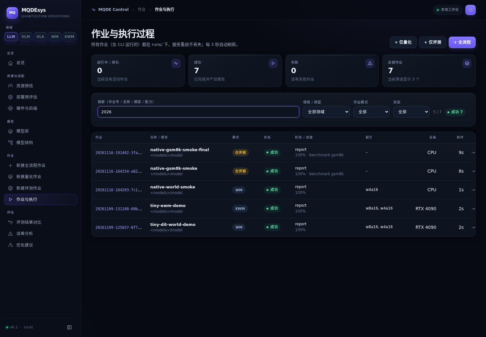
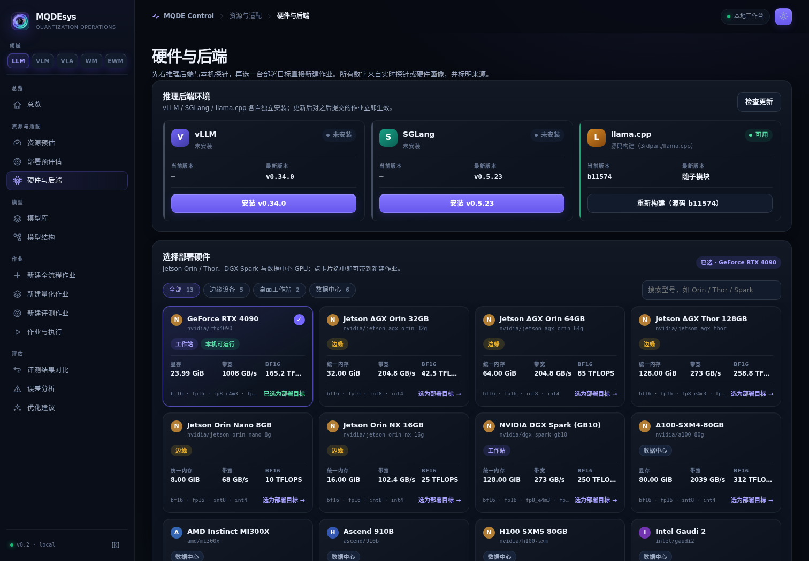
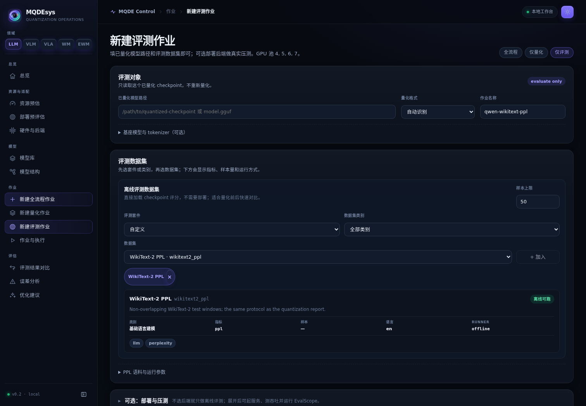

<p align="center">
  
</p>

<p align="center">
  <a href="README_zh.md">中文</a> &nbsp;｜&nbsp; <b>English</b>
</p>

<p align="center">
  <a href="https://zhipingwoods.github.io/MQDEsys/">Live showcase</a>
</p>

<p align="center">
  
  
  
  
  <a href="docs/site/en/index.md"></a>
</p>

MQDEsys is an integrated platform for large-model quantization, evaluation and deployment. Given a model, a quantization recipe, evaluation datasets and target hardware, MQDEsys performs resource estimation, quantization, dataset evaluation, weight export, inference deployment and load testing, and records the complete experiment in one job.

## Overview








## Capabilities

### Resource estimation and hardware fit

- Estimates weights, quantization metadata, KV cache, activations and runtime overhead without loading model weights;
- Computes peak memory, maximum concurrency and TTFT / TPOT lower bounds;
- Produces cross-hardware recommendations for edge devices, workstations and data-centre GPUs;
- Includes hardware profiles for NVIDIA Jetson Orin / Thor, DGX Spark, RTX, H100, AMD MI300X, Intel Gaudi, Ascend and MetaX;
- Uses FlagTree-style targets and HAL plugins for device discovery.

### Quantization

- RTN, GPTQ, AWQ, HQQ, SmoothQuant, FP8 and combined algorithms;
- Mixed-precision rules and KV-cache quantization;
- Per-layer and per-modality error attribution;
- Fake-quant versus real-checkpoint numerical consistency checks.

### Dataset evaluation

- Built-in WikiText-2 PPL, Smoke QA and Smoke MCQ offline benchmarks;
- Native GSM8K, MMLU, ARC-Challenge, HellaSwag and Winogrande runners;
- An EvalScope dataset catalogue covering knowledge, mathematics, code, Chinese, long context, instruction following and Agent tasks;
- PPL, MCQ, QA and category-accuracy report views;
- Optional lm-eval and EvalScope integrations.

### Deployment and benchmarking

- vLLM, SGLang and llama.cpp;
- GPTQ, AWQ, compressed-tensors and GGUF checkpoints;
- Served PPL, TTFT, TPOT, ITL, throughput and concurrency saturation;
- Native continuous-output serving for VLA, WM and EWM through `/v1/actions` and `/v1/video`.

### Model library

- Local models and the HuggingFace catalogue;
- Live HuggingFace and ModelScope search, weight-group inspection and resumable downloads.

## Components

| Component | Responsibility |
|-----------|----------------|
| C++ control plane | Estimation, planning, device probes, numerical core, HAL and REST API |
| Python executor | Quantization algorithms, model adapters, evaluation, export and pipelines |
| React console | Jobs, estimation, hardware, model library and result analysis |
| Data directory | Recipes, hardware profiles, backend parameters and evaluation catalogues |

## Job modes

| Mode | Description |
|------|-------------|
| Full pipeline | Estimate → quantize → evaluate → export → deploy → benchmark |
| Quantize only | Produce and export a reusable checkpoint without evaluation or deployment |
| Evaluate only | Load an existing quantized checkpoint and run dataset evaluation |

## Quick start

### Build

```bash
git clone https://github.com/zhipingwoods/MQDEsys.git
cd MQDEsys

cmake --preset dev
cmake --build --preset dev -j 32
ctest --preset dev

pip install -e "python[dev,quant]"
PYTHONPATH=python pytest python/tests -q

cd web && npm install && npm run build && cd ..
```

### Start the server

```bash
build/dev/bin/mqde serve \
  --repo "$PWD" \
  --runs "$PWD/runs" \
  --web "$PWD/web/dist" \
  --python "$(which python)" \
  --gpus 0,1 \
  --allow /path/to/models \
  --port 18080
```

The server listens on `127.0.0.1:18080` by default.

### Static showcase and interactive demo

Live showcase: [https://zhipingwoods.github.io/MQDEsys/](https://zhipingwoods.github.io/MQDEsys/)

```bash
# Static product showcase
python3 -m http.server 19090
# http://127.0.0.1:19090/site/

# Interactive Gradio demo over the same REST API
pip install -r demo/requirements-gradio.txt
MQDE_API=http://127.0.0.1:18080 python demo/gradio_app.py
# http://127.0.0.1:7860/
```

## Supported range

| Dimension | Support |
|-----------|---------|
| Model domains | LLM, VLM, VLA, World Model, EWM |
| Quantization recipes | W8A16, FP8, W4A16, W4A8, W2A16, W2A8, BF16 |
| Algorithms | RTN, GPTQ, AWQ, HQQ, SmoothQuant and combinations |
| Evaluation | PPL, MCQ, QA, native datasets, lm-eval, EvalScope and layer/modality error analysis |
| Serving backends | vLLM, SGLang, llama.cpp |
| Hardware | NVIDIA, AMD, Intel, Ascend, MetaX and edge/workstation devices |
| Model sources | Local directories, HuggingFace, ModelScope |

## Layout

| Path | Content |
|------|---------|
| `cpp/` | C++20 control plane, estimator, planner, HAL and REST API |
| `python/mqde/` | Python executor, algorithms, evaluation, export and pipelines |
| `web/` | React + TypeScript + ECharts front end |
| `data/` | Recipes, hardware profiles, backend parameters and evaluation catalogues |
| `examples/jobs/` | JobSpec examples |
| `docs/` | User documentation (Sphinx sources) |
| `docs/site/` | Bilingual documentation site |
| `site/` | Static product showcase |
| `demo/` | Interactive Gradio demo |

## Documentation

| Document | Content |
|----------|---------|
| [docs/site/zh/index.md](docs/site/zh/index.md) | Chinese user guide |
| [docs/site/en/index.md](docs/site/en/index.md) | English user guide |
| [docs/site/en/advanced/architecture.md](docs/site/en/advanced/architecture.md) | System architecture |
| [docs/site/en/get_started/installation.md](docs/site/en/get_started/installation.md) | Build and deploy |
| [docs/site/en/user_guides/rest_api.md](docs/site/en/user_guides/rest_api.md) | REST API reference |

Build the documentation site:

```bash
cd docs/site
pip install -r requirements.txt
make html
```

## References

- [EvalScope](https://github.com/modelscope/evalscope): evaluation dataset catalogue, reports and documentation structure;
- [Unsloth](https://github.com/unslothai/unsloth): quantization and fine-tuning workflows;
- [GPTQModel](https://github.com/ModelCloud/GPTQModel): GPTQ / AWQ quantization and export;
- [llmfit](https://github.com/AlexsJones/llmfit): resource estimation and hardware fit;
- [Netron](https://github.com/lutzroeder/netron): weight and graph visualisation;
- [FlagTree](https://github.com/flagos-ai/FlagTree): multi-platform targets and backend adaptation.

These projects live under `3rdpart/` as git submodules; their source is not distributed with this repository.

## License

MQDEsys uses the MIT terms together with an additional commercial contribution
covenant. Commercial users must allocate 20% of attributable gross revenue to
the project; 40% of that contribution is distributed among recognized
contributors and 60% funds project maintenance and development. See
[LICENSE](LICENSE) for the complete terms.
