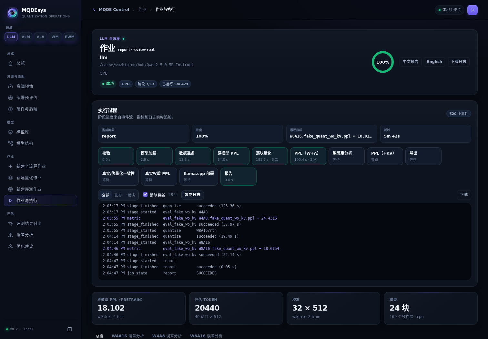

<p align="center">
  <b>MQDEsys</b><br>
  Model Quantization &amp; Deployment Evaluation System<br>
  模型量化部署评估系统
</p>

<p align="center">
  <a href="README_EN.md">English</a> &nbsp;｜&nbsp; <b>中文</b>
</p>

<p align="center">
  <a href="https://zhipingwoods.github.io/MQDEsys/">在线展示页</a>
</p>

<p align="center">
  
  
  
  
  <a href="docs/site/zh/index.md"></a>
</p>

MQDEsys 是面向大模型量化、评测与部署的一体化实验平台。用户指定模型、量化配方、评测数据和目标硬件后，系统完成资源预估、量化、数据集评测、权重导出、推理部署和性能压测，并在统一的作业记录中保存全过程数据。

## 系统概览





## 核心能力

### 资源预估与硬件适配

- 在不加载模型权重的前提下计算权重、量化元数据、KV Cache、激活和运行时开销；
- 计算单并发与多并发峰值显存、最大并发数、TTFT / TPOT 下界；
- 对同一模型在边缘设备、工作站和数据中心 GPU 上生成跨硬件部署建议；
- 支持 NVIDIA Jetson Orin / Thor、DGX Spark、RTX、H100、AMD MI300X、Intel Gaudi、Ascend、MetaX 等硬件画像；
- 使用 FlagTree 风格 target 描述计算平台，并通过 HAL 插件读取设备信息。

### 量化

- 支持 RTN、GPTQ、AWQ、HQQ、SmoothQuant、FP8 及组合算法；
- 支持混合精度规则、KV Cache 量化；
- 逐层、逐模态追踪量化误差，定位到具体 block、线性层和转换环节；
- 支持 fake-quant 与真实 checkpoint 的数值一致性校验。

### 数据集评测

- 内置 WikiText-2 PPL、Smoke QA、Smoke MCQ 离线评测；
- 原生支持 GSM8K、MMLU、ARC-Challenge、HellaSwag、Winogrande；
- 提供 EvalScope 数据集目录，覆盖知识、数学、代码、中文、长上下文、指令遵循和 Agent 等类别；
- 支持 PPL、MCQ、QA 和分类准确率等报告视图；
- 可选集成 lm-eval 与 EvalScope 命令行工具。

### 部署与压测

- 支持 vLLM、SGLang、llama.cpp；
- 支持 GPTQ、AWQ、compressed-tensors 和 GGUF 权重；
- 提供部署后 PPL、TTFT、TPOT、ITL、吞吐量和并发饱和点；
- 为 VLA、WM、EWM 提供原生连续输出服务：`/v1/actions` 与 `/v1/video`。

### 模型库

- 支持本地模型和 HuggingFace 模型目录；
- 支持 HuggingFace、ModelScope 在线搜索、权重组查看和断点续传下载。

## 系统组成

| 组件 | 职责 |
|------|------|
| C++ 控制面 | 资源预估、规划、硬件探针、数值核心、HAL、REST API |
| Python 执行器 | 量化算法、模型适配、数据集评测、权重导出、作业流水线 |
| React 控制台 | 作业管理、资源预估、硬件与后端、模型库和结果分析 |
| 数据目录 | 配方、硬件画像、后端参数和评测数据集目录 |

## 作业模式

| 模式 | 说明 |
|------|------|
| 全流程 | 预估 → 量化 → 评测 → 导出 → 部署 → 压测 |
| 仅量化 | 生成并导出可复用 checkpoint，不执行评测或部署 |
| 仅评测 | 直接加载已有量化 checkpoint，执行数据集评测 |

## 快速开始

### 构建

```bash
git clone https://github.com/zhipingwoods/MQDEsys.git
cd MQDEsys

cmake --preset dev
cmake --build --preset dev -j 32
ctest --preset dev

pip install -e "python[dev,quant]"
PYTHONPATH=python pytest python/tests -q

cd web && npm install && npm run build && cd ..
```

### 启动服务

```bash
build/dev/bin/mqde serve \
  --repo "$PWD" \
  --runs "$PWD/runs" \
  --web "$PWD/web/dist" \
  --python "$(which python)" \
  --gpus 0,1 \
  --allow /path/to/models \
  --port 18080
```

服务默认监听 `127.0.0.1:18080`。

### 静态展示页与交互式 Demo

在线展示页：[https://zhipingwoods.github.io/MQDEsys/](https://zhipingwoods.github.io/MQDEsys/)

```bash
# 静态产品展示页
python3 -m http.server 19090
# http://127.0.0.1:19090/site/

# Gradio 交互式 Demo（调用同一套 REST API）
pip install -r demo/requirements-gradio.txt
MQDE_API=http://127.0.0.1:18080 python demo/gradio_app.py
# http://127.0.0.1:7860/
```

## 支持范围

| 维度 | 支持内容 |
|------|----------|
| 模型领域 | LLM、VLM、VLA、World Model、EWM |
| 量化配方 | W8A16、FP8、W4A16、W4A8、W2A16、W2A8、BF16 |
| 量化算法 | RTN、GPTQ、AWQ、HQQ、SmoothQuant、组合算法 |
| 评测 | PPL、MCQ、QA、原生数据集、lm-eval、EvalScope、逐层 / 逐模态误差 |
| 推理后端 | vLLM、SGLang、llama.cpp |
| 硬件 | NVIDIA、AMD、Intel、Ascend、MetaX，以及 Jetson / DGX Spark 等边缘和工作站设备 |
| 模型来源 | 本地目录、HuggingFace、ModelScope |

## 目录结构

| 路径 | 内容 |
|------|------|
| `cpp/` | C++20 控制面、预估器、规划器、HAL 和 REST API |
| `python/mqde/` | Python 执行器、算法、评测、导出和流水线 |
| `web/` | React + TypeScript + ECharts 前端 |
| `data/` | 配方、硬件画像、后端参数、评测数据集目录 |
| `examples/jobs/` | JobSpec 示例 |
| `docs/` | 用户文档（Sphinx 源码） |
| `docs/site/` | 中英文文档站点 |
| `site/` | 静态产品展示页 |
| `demo/` | Gradio 交互式 Demo |

## 文档

| 文档 | 内容 |
|------|------|
| [docs/site/zh/index.md](docs/site/zh/index.md) | 中文用户文档 |
| [docs/site/en/index.md](docs/site/en/index.md) | English user guide |
| [docs/site/zh/advanced/architecture.md](docs/site/zh/advanced/architecture.md) | 系统架构 |
| [docs/site/zh/get_started/installation.md](docs/site/zh/get_started/installation.md) | 构建与部署 |
| [docs/site/zh/user_guides/rest_api.md](docs/site/zh/user_guides/rest_api.md) | REST API 参考 |

构建文档站点：

```bash
cd docs/site
pip install -r requirements.txt
make html
```

## 参考项目

- [EvalScope](https://github.com/modelscope/evalscope)：评测数据集目录、评测报告和文档组织；
- [Unsloth](https://github.com/unslothai/unsloth)：量化与微调工作流；
- [GPTQModel](https://github.com/ModelCloud/GPTQModel)：GPTQ / AWQ 量化与导出；
- [llmfit](https://github.com/AlexsJones/llmfit)：资源预估与硬件适配；
- [Netron](https://github.com/lutzroeder/netron)：权重与计算图可视化；
- [FlagTree](https://github.com/flagos-ai/FlagTree)：多平台 target 与后端适配。

以上项目位于 `3rdpart/`，以 git submodule 形式引用，源码不随本仓库分发。

## 许可证

MIT，见 [LICENSE](LICENSE)。
